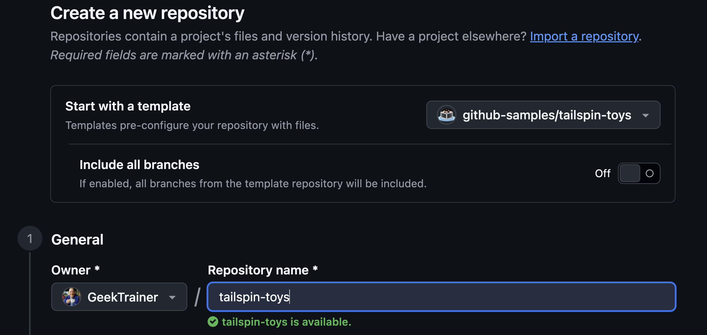

GitHub Copilot app は、Copilot と GitHub の両方を一元的に扱うデスクトップアプリです。issue やプルリクエストにすばやくアクセスでき、GitHub Copilot を使った開発もできます。このワークショップでは、自分のコンピューターで GitHub Copilot app を使い、Astro で構築された Tailspin Toys アプリを更新します。始める前に、ローカル環境に Node.js がインストールされていることを確認し、次に Copilot app をインストールします。

このレッスンでは、次のことを行います。

- プロジェクトのテストをコンピューター上で実行できるように Node.js をインストールします。
- テンプレートから Tailspin Toys プロジェクトの自分用コピーを作成します。

## Node.js をインストールする

いくつかのレッスンでは、エージェントに機能を実装させ、Tailspin Toys のテストスイートをローカルで実行します。そのためには **[Node.js][nodejs]** が必要です。これはプロジェクトに必要な唯一のランタイムです。現在の **LTS** リリースをインストールしてください。

どのプラットフォームでも、公式インストーラーを使うのが最も簡単です。

1. Windows Terminal、macOS のターミナル、または普段使用しているターミナルを開きます。
2. 次のコマンドを実行し、インストールされている Node.js のバージョンを確認します。

    ```shell
    node --version
    npm --version
    ```

3. 両方のコマンドが成功し、Node.js がプロジェクトの README と `package.json` に記載された要件を満たしている場合は、次のセクションに進めます。

> [!TIP]
> Node.js がインストールされていない場合、または更新が必要な場合にのみ、以降の手順を実行してください。

4. [Node.js のダウンロードページ][node-download]を開きます。
5. 使用しているオペレーティングシステム向けの **LTS** ビルドをダウンロードします。
6. インストーラーを実行し、既定の設定を選択します。Windows では **Add to PATH** を選択したままにします。
7. インストール後、新しいターミナルウィンドウを開きます。
8. 新しいターミナルで次のコマンドを実行し、インストールを確認します。

    ```bash
    node --version
    npm --version
    ```

9. インストール済みの Node.js と npm のバージョンが表示されることを確認します。

> [!IMPORTANT]
> Copilot app のエージェントも `node --version` と `npm --version` を実行できる必要があります。普段使用するターミナルで成功しても、アプリから利用できるとは限りません。Node.js のインストール後、または PATH を変更した後は、アプリを完全に終了して再起動してください。セッション内でいずれかのコマンドがまだ失敗する場合は、続行する前に[セッション環境のトラブルシューティング手順][session-environment]を確認してください。

> [!IMPORTANT]
> 各 worktree には、プロジェクトの依存関係と E2E チェック用の Playwright Chromium も必要です。worktree の準備では Tailspin Toys リポジトリの README に従い、インストール要求は内容を確認してから承認してください。

## ラボ用リポジトリを設定する

Tailspin Toys プロジェクトの自分用コピーを使って作業します。[テンプレートリポジトリ][template-repository]から作成してください。新しいリポジトリにはラボに必要なファイルがすべて含まれます。アプリをインストールするときに接続します。

1. 新しいブラウザーウィンドウで、このラボの GitHub リポジトリ `https://github.com/github-samples/tailspin-toys` に移動します。
2. ラボ用リポジトリのページで **Use this template** ボタンを選択し、**Create a new repository** を選択して自分用のコピーを作成します。

    

3. GitHub または Microsoft が主催するイベントでワークショップに参加している場合は、メンターの指示に従ってください。それ以外の場合は、GitHub Copilot を利用できる組織に新しいリポジトリを作成できます。

    

4. 作成したリポジトリのパス (**organization-or-user-name/repository-name**) を控えておきます。ラボで後から参照します。

> [!NOTE]
> テンプレートからリポジトリを作成すると、GitHub issue のバックログも自動で作成されます。ワークショップではこの issue を使います。自分で issue を登録する必要はありません。

ワークショップのテンプレートの新しいコピーを使用してください。リポジトリの指示、アプリケーションコード、テスト、`quality-checks` スキル、既存のキャンバス拡張機能が含まれています。ワークショップ中にスキルをカスタマイズし、QA エージェントを作成します。古いコピーを使用する場合は、必要なファイルが含まれているか進行役に確認してください。

## まとめと次のステップ

準備ができました。このレッスンでは、次のことを行いました。

- プロジェクトをコンピューター上でビルドしてテストできるように Node.js をインストールしました。
- テンプレートから Tailspin Toys リポジトリの自分用コピーを作成しました。

次は[GitHub Copilot app をインストールし][next-lesson]、作成したリポジトリを接続して、ワークスペースを確認します。

## リソース

- [Node.js のダウンロード][node-download]
- [テンプレートからリポジトリを作成する][template-repository]
- [GitHub Copilot app について][about-copilot-app]

[next-lesson]: ../1-install-copilot-app/
[nodejs]: https://nodejs.org/
[node-download]: https://nodejs.org/en/download
[template-repository]: https://docs.github.com/repositories/creating-and-managing-repositories/creating-a-template-repository
[about-copilot-app]: https://docs.github.com/copilot/concepts/agents/github-copilot-app
[session-environment]: ../3-agent-modes/#issue-からセッションを開始する
